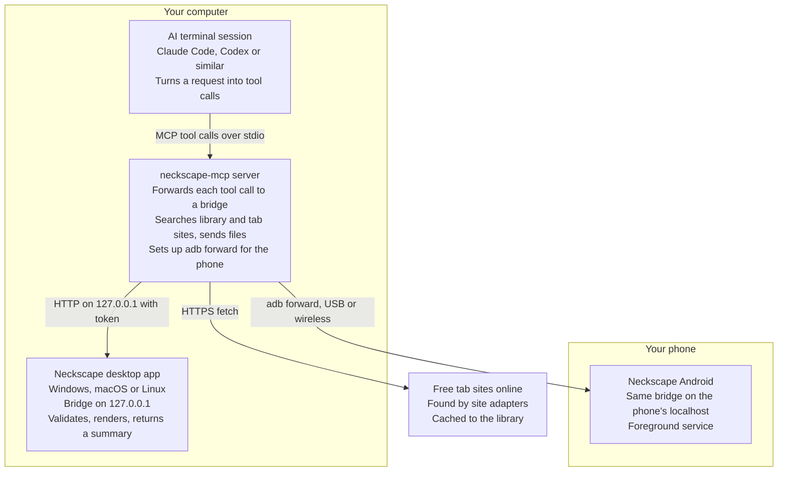

# Neckscape — AI Integration Spec

Chris Snow · 2 November 2026

> Implemented in NeckScape-Navigator 1.1 — see [Implementation notes](#implementation-notes)
> at the end for what was built, the answers to the open questions, and where
> it differs from the text above them.

## Purpose and scope

Any terminal AI session (Claude Code, Codex or similar) should be able to push chords, progressions, scales and tabs into a running Neckscape app on Android, Windows, macOS or Linux. Each app exposes a small local API, one shared MCP server wraps it, and all four apps speak the same JSON format.

In scope for v1: showing what the AI sends, reporting what is on screen, and finding or importing tabs from the user's library or free tab sites online. Out of scope: the AI changing app settings beyond tuning, capo and display mode, and any access from outside the user's own computer and phone.

## Example requests

Chord and solo requests both take one prompt. The AI writes chord progressions itself; a solo's notes come from a real transcription, which the AI finds and loads.

**"Show me the chords for House of the Rising Sun in Neckscape."** The AI builds a Progression from its own knowledge (a traditional song; the common A minor arrangement is Am C D F | Am C E E | Am C D F | Am E Am E). It calls `load_progression`, then reads back `rendered_summary` to confirm what landed. If the user wants a different version or key, the AI edits that progression rather than starting over.

**"Tab me the solo of Free Bird in Neckscape."** The AI calls `find_tab` with the song and the part (`solo`). The MCP server searches the user's tab library first, then free tab sites online, and loads the best-rated match with the solo section selected. From the user's side it is the same one-line request as chords.

The AI doesn't write the solo from memory. A recorded solo's transcription is copyrighted, so assistants generally won't reproduce it note for note, and a long solo recalled from memory comes out mostly wrong. If `find_tab` finds nothing, the AI says so and offers the key, scale positions and original licks in that style instead.

## Architecture

Three pieces: the AI session, one shared MCP server, and a small bridge inside each app. Keeping MCP out of the apps means one MCP implementation for four apps, and each bridge can be tested with curl before any AI is involved.



The AI session never talks to an app directly: the MCP server forwards each call over localhost HTTP, or over an adb port forward when the target is the phone. It is also the only part that goes online, to search and fetch tabs. Every app shares JSON schema v1 and its test fixtures.

## Data model

One JSON format, versioned, shared by all four apps and the MCP server. Every payload carries `schema_version` and a `type` of `progression`, `tab` or `scale`.

Conventions that must not drift between platforms:

- Note names are a letter plus accidental (`Bb`, `F#`); an octave is added where pitch matters (`E2`).
- Strings are numbered tab-style: 1 is the highest-pitched string.
- Fret arrays for chord voicings run lowest string to highest, like `x02210`. `null` is a muted string, `0` is open.
- Rhythm is in quarter notes: `at` is the position from the start of the measure (0, 0.5, 1…), `dur` is the length (0.5 = an eighth).
- The tuning's length sets the string count, so 7-string guitars and basses work with no extra fields.
- `source` is one of `ai_generated`, `user_file`, `user_typed` or `online`. Online content also carries `source_url`, `author` and `rating` where the site gives them. The app labels AI-generated and online content on screen.
- There is deliberately no lyrics field.

### Progression

Bars list chord symbols, split evenly across the bar; a `chords` table gives each symbol's voicing. A symbol with no voicing gets one chosen by the app using `voicing_style` (`open`, `barre`, `position_N`, `drop2`). Optional fields: `tempo_bpm`, `capo`, `repeat` per section.

```json
{
  "schema_version": "1.0",
  "type": "progression",
  "source": "ai_generated",
  "title": "House of the Rising Sun",
  "attribution": "Traditional",
  "key": { "tonic": "A", "mode": "minor" },
  "time_signature": "6/8",
  "tuning": { "name": "Standard", "strings": ["E2", "A2", "D3", "G3", "B3", "E4"] },
  "voicing_style": "open",
  "chords": {
    "Am": { "frets": [null, 0, 2, 2, 1, 0] },
    "C":  { "frets": [null, 3, 2, 0, 1, 0] },
    "D":  { "frets": [null, null, 0, 2, 3, 2] },
    "F":  { "frets": [1, 3, 3, 2, 1, 1] },
    "E":  { "frets": [0, 2, 2, 1, 0, 0] }
  },
  "sections": [
    {
      "name": "Verse",
      "bars": [["Am"], ["C"], ["D"], ["F"], ["Am"], ["C"], ["E"], ["E"],
               ["Am"], ["C"], ["D"], ["F"], ["Am"], ["E"], ["Am"], ["E"]]
    }
  ]
}
```

### Tab

Measures hold events; an event with an empty `notes` list is a rest. Techniques: `bend` (with `semitones`), `release`, `slide_to` (with `fret`), `hammer_on`, `pull_off`, `vibrato`, `palm_mute`, `harmonic`, `let_ring`. `dur` may be `null` in tabs parsed from plain text, which rarely record rhythm; those tabs display in order but don't play back.

```json
{
  "schema_version": "1.0",
  "type": "tab",
  "source": "ai_generated",
  "title": "A minor pentatonic lick",
  "attribution": "Original exercise",
  "tuning": { "name": "Standard", "strings": ["E2", "A2", "D3", "G3", "B3", "E4"] },
  "time_signature": "4/4",
  "measures": [
    { "events": [
      { "at": 0,   "dur": 0.5, "notes": [{ "string": 2, "fret": 8 }] },
      { "at": 0.5, "dur": 0.5, "notes": [{ "string": 2, "fret": 5 }] },
      { "at": 1,   "dur": 1,   "notes": [{ "string": 3, "fret": 7, "technique": { "type": "bend", "semitones": 2 } }] }
    ]}
  ]
}
```

### Scale overlay

`scale` is a name from a fixed list the app publishes in `get_app_info`, or `intervals` in semitones for anything custom. `fret_range` limits the display to one position.

```json
{
  "schema_version": "1.0",
  "type": "scale",
  "root": "A",
  "scale": "minor_pentatonic",
  "fret_range": [5, 8],
  "highlight": { "roots": true, "chord_tones_of": "Am" }
}
```

## MCP tools

Fourteen tools cover v1. Every tool except `list_targets` takes an optional `target`; with one instance running it can be left out.

| Tool | Input | What it does |
| --- | --- | --- |
| `list_targets` | none | Lists reachable Neckscape instances (desktop app, phone over adb) with their names |
| `get_app_info` | none | App version, platform, schema version, supported scales, voicing styles and import formats |
| `get_state` | none | What is on screen: type, title, key, tuning, capo, current bar, playback state |
| `set_tuning` | tuning, capo | Changes tuning and capo; current content re-renders |
| `show_chord` | chord, voicing_style | Shows one chord; the app picks a voicing if none is given |
| `load_progression` | progression | Replaces the current content with a progression |
| `load_tab` | tab | Replaces the current content with a tab |
| `find_tab` | song, artist, part, track | Searches the user's tab library, then free tab sites online; loads the best-rated match at the named part, or returns the candidates when it's ambiguous |
| `import_url` | url | Fetches and loads a tab from a page the AI found or the user pasted, through the matching site adapter |
| `show_scale` | scale, overlay (true/false) | Shows a scale alone, or over the current content |
| `highlight_notes` | positions or note names, label | Marks arbitrary notes, e.g. every C on the neck |
| `import_file` | path, format | Loads a user file: Guitar Pro, MusicXML, ASCII tab, or ChordPro (chords kept, lyrics dropped) |
| `playback` | play, stop or loop; section; tempo_pct | Controls playback, where the app has audio |
| `clear` | none | Empties the neck |

`get_state` matters more than it looks: it lets the AI build on what is showing ("now add a bridge", "move it to G") instead of resending from scratch. For `find_tab` and `import_file`, the MCP server reads files on the computer and sends their contents, so the same calls work when the target is the phone.

The tab library is a folder the user chooses in the MCP server's config. The server indexes title, artist, tracks and section markers from the Guitar Pro and MusicXML files in it, so `part: solo` lands on the right bars when the file marks them. Unmarked files open at the start of the lead guitar track.

Online search runs through one adapter per tab site, listed in the MCP server's config. Each adapter searches its site, reads the rating or vote count where one is shown, and converts the result to Neckscape JSON. Guitar Pro downloads are parsed directly; plain-text tabs are parsed from their layout, using labels like `[Solo]` to find the part.

Results are ranked by how well they match, then format (Guitar Pro first, since it carries rhythm), then rating. Whatever loads is saved to the library folder with its source URL and author, so the next request for that song works offline.

## Responses, validation and errors

The app validates every payload and says what it rendered, so the AI can catch its own mistakes. The MCP server only forwards; the app is the source of truth, and all four apps run the same checks against a shared set of test fixtures.

Every tool returns the same shape:

```json
{
  "ok": true,
  "warnings": [{ "code": "VOICING_MISMATCH", "path": "chords.F", "detail": "Frets give F major 7, not F" }],
  "rendered_summary": "Verse: 16 bars, 5 chords (Am C D F E), open voicings, A minor, 6/8"
}
```

The voicing check is the important one: AI-written fret numbers are sometimes wrong, and a warning naming the actual chord lets the AI fix it in the next call.

| Code | Kind | Meaning |
| --- | --- | --- |
| `INVALID_SCHEMA` | error | Payload fails the schema; `path` names the bad field |
| `UNSUPPORTED_VERSION` | error | `schema_version` is newer than the app understands |
| `UNSUPPORTED_FORMAT` | error | `import_file` format the app can't read |
| `NOT_FOUND` | error | `find_tab` found no match in the library or online |
| `PARSE_FAILED` | error | A fetched or imported tab couldn't be converted to Neckscape JSON |
| `NO_TARGET` | error | No Neckscape instance reachable |
| `AUTH_FAILED` | error | Token missing or wrong |
| `VOICING_MISMATCH` | warning | Frets don't produce the chord named |
| `UNPLAYABLE_VOICING` | warning | Stretch over the app's limit, or frets beyond the neck |
| `STRING_COUNT` | warning | Voicing or tab uses more strings than the tuning has |
| `BAR_LENGTH` | warning | Events overrun or underfill the measure |

## Content rules

AI assistants will generally give a song's chords, but not its lyrics or a note-for-note transcription of a recorded part. Building around that means no feature that fails on its first real request.

- **Lyrics.** The schema has no lyrics field; ChordPro import and the plain-text tab parser drop them.
- **AI-written tabs** are for original licks and exercises, traditional and public-domain tunes, and the user's own compositions.
- **Solos and riffs from recordings** come through `find_tab`, `import_url` or `import_file`, from the user's library or tabs freely published online, never from the AI's memory. The user still asks for them in one line, as with chords.
- **Accuracy.** Chords recalled by an AI can be wrong, and free online tabs are user-submitted and vary in quality. The app labels AI-generated content "check by ear" and shows each online tab's source site and rating.
- **Distribution.** Before Neckscape goes to other people, check each tab site's terms (many restrict automated access) and whether the tabs it serves are licensed.

## Security

Nothing outside the user's own computer and USB-connected phone can reach the bridge by default.

- **Localhost only.** The desktop bridge binds to `127.0.0.1`, never `0.0.0.0`. The Android bridge binds to the phone's own localhost.
- **Token.** Each app generates a random token on first launch, shown in Settings with copy and regenerate buttons. The MCP server reads it from `NECKSCAPE_TOKEN` and sends it as a bearer header.
- **No paths across the bridge.** The bridge accepts JSON payloads and file contents, never file paths, so the API can't be used to read files on the device.
- **Size limit.** Payloads over a fixed size are rejected before parsing.
- **Outbound fetching** happens only in the MCP server, only to sites with an adapter, under a size limit and timeout. Fetched pages and files are parsed as untrusted input, and the apps themselves make no outbound requests.
- **LAN mode** (Android over Wi-Fi) is off by default. Turning it on requires a pairing code shown on the phone, and the setting warns to use it only on trusted networks.

## Android transport

The AI runs on the computer, so the phone is reached over adb: a port forward for normal use, an intent for small one-off pushes.

**Primary: adb port forward.** The app runs the same bridge as the desktop apps, on the phone's localhost. The MCP server checks `adb devices` and sets up `adb forward tcp:<port> tcp:<port>` itself when the target is Android, so the computer talks to the phone as if it were local. It works over USB or wireless debugging. Android may stop a background server, so the bridge runs while the app is open, or as a foreground service with its notification showing.

**Fallback: intent.** For small payloads with no server running:

```bash
adb shell am start -n <package>/.MainActivity -a <package>.LOAD --es payload '<json>' --es token '<token>'
```

Shell quoting and command-length limits make this fragile for anything large, so tabs and imports use the port forward. Because other apps on the phone can also send intents, the receiver checks the token before acting.

## Build order

Get one app working end to end with three tools before widening out; the shared fixtures then keep the other apps honest.

1. **Schema and fixtures.** JSON Schema files plus good and bad sample payloads, each with its expected warnings. Every app's validator must pass them.
2. **Bridge in one desktop app** (whichever is furthest along), with `get_app_info`, `get_state` and `load_progression`.
3. **MCP server** with those three tools, registered in Claude Code. Done when "show me the chords for House of the Rising Sun in Neckscape" works end to end.
4. **Remaining tools** in that app: `show_chord`, `show_scale`, `highlight_notes`, `load_tab`, `set_tuning`, `clear`.
5. **Other two desktop apps**, proven against the same fixtures.
6. **Android**: the bridge, the adb forward in the MCP server, then the intent fallback.
7. **Imports**: ChordPro and ASCII tab first, then MusicXML and Guitar Pro, then the tab library and online search behind `find_tab` and `import_url`.
8. **Playback**.

## Open questions

- [x] Do the four apps share a core library? If so, the bridge and validator are written once there; if not, four times against the fixtures.
- [x] Default port, and what happens when two desktop instances run at once.
- [x] MCP server language: Python or TypeScript, matching whichever the apps' tooling already uses.
- [x] Should the app keep an undo history of AI pushes, so a bad push is one tap to reverse?
- [x] Library for reading Guitar Pro files on each platform.
- [x] Which tab sites get adapters first, and do their terms allow automated access?
- [x] Bass and 7-string support in v1, or later?

## Implementation notes

What NeckScape-Navigator 1.1 does, by section.

**Open questions, answered.**

- *Shared core:* yes. Android, Windows, macOS and Linux all compile the same Kotlin
  (`app/.../song`, `bridge`, `ui`), so the validator, importers and bridge exist once.
  The fixtures still run against both builds (`SongTest`, desktop `BridgeTest`) and
  against the JSON Schemas (`mcp/test_fixtures.py`).
- *Port:* 47621. A second desktop instance takes the next free port up to 47630; each
  instance writes a discovery file the MCP server reads, so `list_targets` shows both.
- *MCP server:* Python (the repo's tooling is Python), using the official MCP SDK.
- *Undo:* yes. Every pushed change (AI or file import) can be undone from the app's
  **Undo** button or the extra `undo` tool; the last 30 are kept.
- *Guitar Pro:* our own reader in shared Kotlin: GP3, GP4, GP5 (5.00/5.10) and GP7/8
  `.gp`. GP6 `.gpx` (a proprietary container) is refused with `UNSUPPORTED_FORMAT`.
- *Tab sites:* none yet. The adapter interface is in `mcp/adapters_base.py`; no
  adapter is enabled because the big tab sites restrict automated access. `find_tab`
  searches the user's library and says so when nothing is found.
- *Bass and 7-string:* in v1 — the tuning's length sets the string count everywhere,
  and bass reads in bass clef.

**Additions and differences.**

- **MIDI** import (`import_file` with format `midi`) and export (in the app's Save menu),
  alongside the formats above. Imported MIDI is placed on the neck automatically.
- **undo** is a fifteenth tool.
- Measures may carry an optional `marker` (e.g. `"Solo"`), which is how imported
  section labels reach the app and how `playback` finds a section in a tab.
- Tab payloads number strings positionally (1 = the first/highest string as written in
  tab), which is what "1 is the highest-pitched string" means for re-entrant tunings
  such as ukulele.
- `tempo_bpm` counts the beat you'd tap: quarters in 4/4, dotted quarters in 6/8.
- Content without rhythm (`dur: null`) shows in order; `playback` answers that it can't
  play it.
- The Android bridge runs while the app is open (no foreground service yet), and
  survives screen rotation. LAN mode binds to Wi-Fi, shows a six-digit pairing code
  (single use, regenerated after five wrong tries), and `POST /v1/pair` swaps the code
  for the token.
- The bridge also refuses requests that carry an `Origin` header or a `Host` that isn't
  this machine, so web pages (including DNS-rebinding attacks) can't drive the app.
- Request bodies are limited to 12 MB (an 8 MB file, base64-encoded); imports to 8 MB.
- For debug builds on a phone, the MCP server can read the token over adb
  (`run-as`), so phone setup needs no copying; release builds use the copied token.
